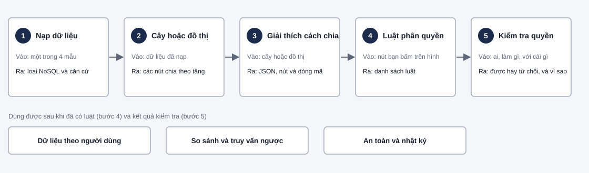

# Demo phân quyền trên NoSQL (NIST IR 8504)

Demo cho môn Hệ cơ sở dữ liệu tiên tiến (IS6002.26.1.CH.02), nhóm 5. Bài báo gốc: NIST IR 8504, *Access Control on NoSQL Databases*.

Demo này làm lại phần **nền tảng** của bài báo: dữ liệu NoSQL được chia thành tầng như thế nào, thuộc tính chủ thể và đối tượng lấy từ đâu, một luật được viết ra sao, và quyền được kế thừa thế nào. Mọi thứ chạy ngay trong trình duyệt, không cần cài CSDL hay khóa API.

Phần sinh luật bằng AI (6 bước) của nhóm chưa có trong bản này.

**Hướng dẫn dùng từng chức năng, kèm sơ đồ luồng và kịch bản demo 7 phút: [docs/HUONG_DAN.md](docs/HUONG_DAN.md).**



## Chạy thử

Cần Node.js 18 trở lên.

```bash
npm install
npm run dev
```

Mở http://127.0.0.1:5173. Chạy kiểm thử và kiểm tra kiểu:

```bash
npm test
npm run typecheck
```

## Đưa lên Netlify

Demo là trang tĩnh, không cần máy chủ hay biến môi trường. Tệp `netlify.toml` đã cấu hình sẵn lệnh build (`npm run build`), thư mục xuất bản (`dist`) và Node 20.

Cách 1, nối với GitHub: vào Netlify, chọn Add new site, Import an existing project, chọn repo này. Giữ nguyên cài đặt Netlify đọc từ `netlify.toml`, bấm Deploy. Mỗi lần push lên `main` Netlify tự build lại.

Cách 2, kéo thả thủ công:

```bash
npm run build
```

Rồi kéo thư mục `dist` vào trang https://app.netlify.com/drop.

Kiểm tra bản build trước khi đưa lên:

```bash
npm run build
npx vite preview
```

Trang tải font từ Google Fonts, nên cần có mạng. Khi mất mạng trang vẫn dùng được với font hệ thống.

## Đi qua demo theo thứ tự

| Bước | Màn hình | Chức năng | Mục của bài |
|---|---|---|---|
| 1 | Nạp dữ liệu | Chọn 1 trong 4 mẫu. Hệ thống nêu loại NoSQL kèm căn cứ, kèm đoạn mã đưa ra kết luận. Chọn vùng chứa chủ thể và vùng chứa đối tượng. | 3.1 |
| 2 | Cây hoặc đồ thị | Key-value, wide-column, document dựng thành cây vẽ từ trên xuống (4 hoặc 5 tầng, mỗi tầng một dải ngang). Graph dựng thành đồ thị có hướng. Dữ liệu sâu quá tầng 5 được gộp và cảnh báo. | 3.1, Fig. 5, 6 |
| 3 | Giải thích cách chia | Chạy từng bước: nút nào sinh ra từ đoạn JSON nào. JSON và dòng mã thật trong `src/core/build.ts` được tô sáng. Bảng ánh xạ đường dẫn JSON sang tầng. | 3.1 |
| 4 | Luật phân quyền | Bấm nút trên hình để chọn thuộc tính chủ thể và đối tượng. Hệ thống đọc lại thành câu tiếng Việt. Luật hiện lên hình: viền xanh dương là chủ thể, viền cam là đối tượng, nền lục là cho phép, nền đỏ là cấm, nút con kế thừa được tô nhạt. | 3.2.1 đến 3.2.3, Fig. 7 đến 10 |
| 5 | Kiểm tra quyền | Chọn chủ thể, hành động, đối tượng. Kết quả kèm từng bước giải thích, đường đi tô trên hình và dòng mã quyết định. Có sẵn kịch bản gợi ý cho từng mẫu. | 3.2, 3.3 |
| thêm | Dữ liệu theo người dùng | Cùng một CSDL, phần không có quyền bị che. | 3.3 |
| thêm | So sánh và truy vấn ngược | Phân quyền mức database (ai có vai trò thì thấy hết) so với luật tuple trên cùng dữ liệu. Truy vấn "ai được truy cập nút này". | 3.2, 3.3, 4.1 |
| thêm | An toàn và nhật ký | Quét chuỗi nguy hiểm như `$where`. Nhật ký mọi lượt kiểm tra, tải về dạng JSON. | 4.2, 4.6 |

Luật có điều kiện (ví dụ `gio >= 8 and gio <= 17`) nằm trong màn hình Luật phân quyền và Kiểm tra quyền. Mục 4.7 của bài chỉ nêu ý tưởng điều kiện môi trường.

## Dữ liệu mẫu

Thư mục `samples/` có 4 tệp JSON, cùng một câu chuyện (công ty A, phòng Kế toán, bộ phận Tài chính). Chủ thể (nhân viên) và đối tượng (tệp) nằm cùng trong CSDL, đúng giả định của bài.

| Tệp | Loại | Số tầng |
|---|---|---|
| `samples/document.json` | Document | 5: Database, Collection, Document, Field, Value |
| `samples/key-value.json` | Key-value | 4: Database, Table, Key, Value |
| `samples/wide-column.json` | Wide-column | 5: Database, Column family, Row, Column, Value |
| `samples/graph.json` | Graph | đồ thị có hướng, cạnh `can read` và `cannot read` là luật |

Mỗi tệp gồm `data` (dữ liệu), `rules` (luật mẫu) và `scenarios` (kịch bản kiểm tra kèm kết quả dự kiến). Tệp `tests/samples.test.ts` chạy mọi kịch bản và so với kết quả dự kiến, nên README và demo không thể lệch nhau mà không bị phát hiện.

Muốn thêm mẫu mới, xem mục "Thêm dữ liệu mẫu mới" trong [hướng dẫn](docs/HUONG_DAN.md). Hệ thống nhận diện loại theo hình dạng dữ liệu:

- Có `nodes` và `edges`: graph.
- Collection chứa mảng đối tượng: document (nhãn document lấy từ `_id`).
- Giá trị nằm ngay dưới khóa của bảng: key-value.
- Giá trị nằm sau hai tầng khóa lồng nhau: wide-column.

## Luật hoạt động thế nào

Luật là tuple của bài (mục 3.2.2), rút gọn: thay vì thuộc tính tự do, mỗi bên là danh sách nút trong cây hoặc đồ thị.

```
{ id, subjectAttrs[], subjectLeaf?, objectAttrs[], objectLeaf?, actions[], permission, condition? }
```

- **Cây:** thuộc tính của một nút là chuỗi tổ tiên của nó, nên luật gán ở nút cha tự áp dụng cho mọi nút con (quyền kế thừa).
- **Graph:** thuộc tính của một nút là mọi nút đi tới được qua cạnh có hướng (trừ cạnh mang quyền). Cạnh `can read` hoặc `cannot read` chính là một luật nằm trong CSDL (Fig. 10).
- Luật khớp khi mọi nút ở mỗi bên đều thuộc tập thuộc tính của chủ thể hoặc đối tượng, hành động trùng và điều kiện (nếu có) đúng.

Các lựa chọn **của nhóm**, bài báo không quy định:

- Cấm thắng cho phép. Nếu không có luật nào khớp thì từ chối mặc định.
- Cú pháp điều kiện: các phép so sánh số nối bằng `and`, không dùng `eval`.
- Bước chặn chuỗi nguy hiểm dùng danh sách mẫu (`$where`, `function(`, `eval(`, và tương tự), chưa phải bộ lọc hoàn chỉnh.

## Cấu trúc mã

```
src/core/     lõi, không phụ thuộc giao diện
  detect.ts     nhận diện loại NoSQL
  build.ts      dựng cây và đồ thị, ghi lại từng bước
  rules.ts      đánh giá luật, giải thích quyết định
  condition.ts  điều kiện đơn giản
  guard.ts      quét chuỗi nguy hiểm
  view.ts       truy vấn ngược, so sánh mức database với tuple
  jsonlines.ts  in JSON và nhớ dòng của từng đường dẫn
  dataset.ts    ghép các phần trên thành một bộ dữ liệu
src/ui/       giao diện React
docs/         hướng dẫn dùng và sơ đồ (SVG)
samples/      4 mẫu dữ liệu, luật và kịch bản
tests/        kiểm thử đơn vị cho lõi (vitest)
```

Các chú thích dạng `@step:...`, `@rule:...`, `@detect:...` trong mã nguồn là mốc để khung mã trên giao diện tô sáng đúng dòng đang chạy. Đừng xóa chúng.

## Giới hạn

- Demo không nối CSDL thật (MongoDB, Neo4j...). Lớp phân quyền chạy trên mô hình cây và đồ thị trong bộ nhớ, và việc "viết lại truy vấn" chưa được làm.
- Không đo hiệu năng.
- Giao diện chỉ nạp 4 mẫu có sẵn. Dữ liệu mới thêm bằng cách tạo tệp trong `samples/`, không dán hay tải lên trực tiếp.
- Sinh luật bằng AI chưa làm.
