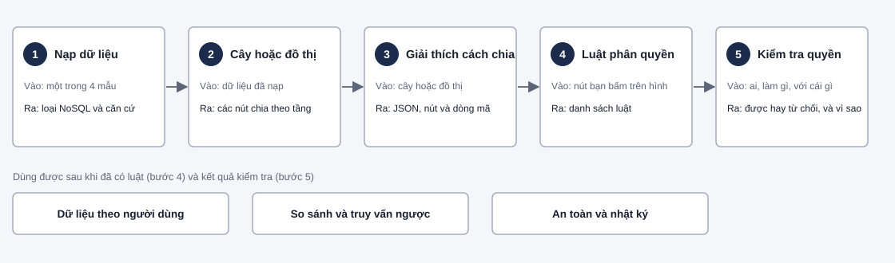
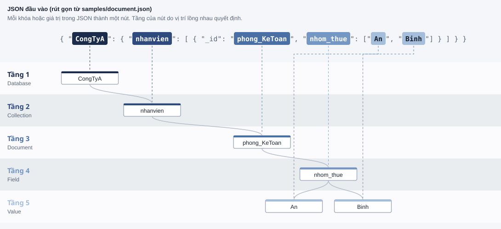
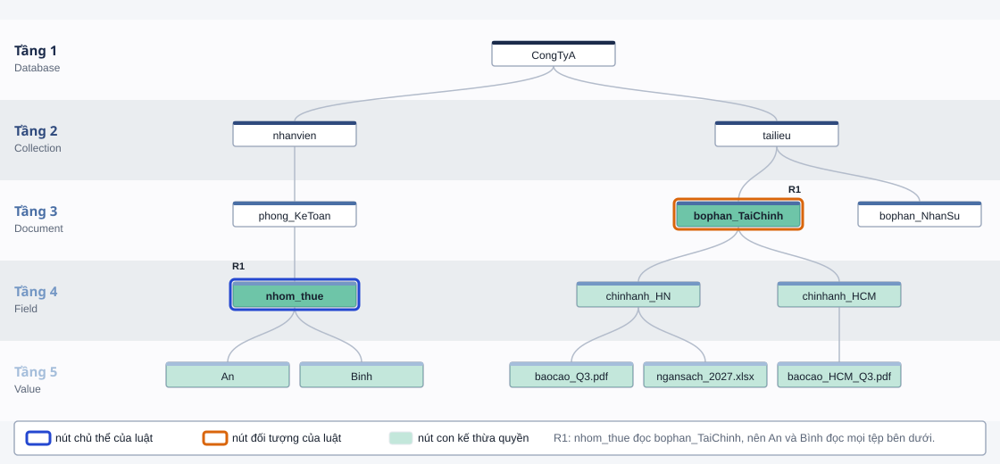
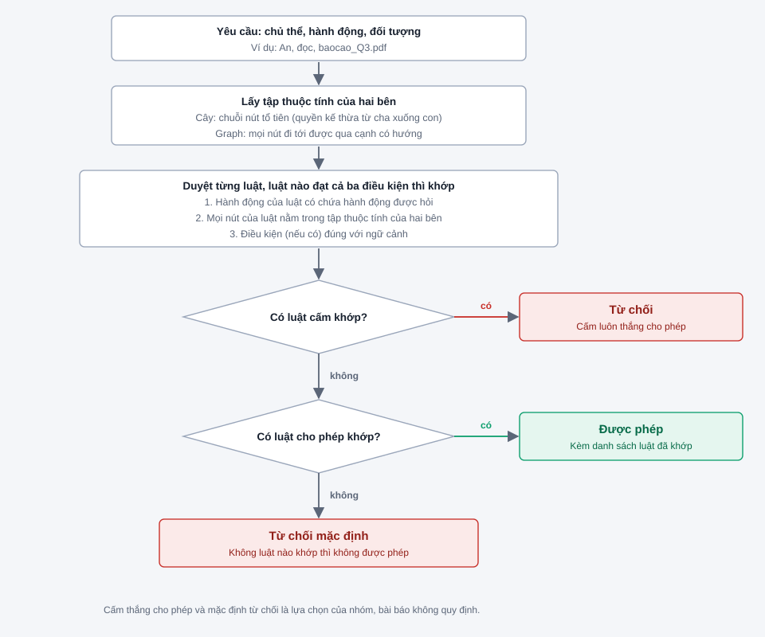

# Hướng dẫn dùng demo cho thành viên nhóm

Tài liệu này dành cho người chưa từng mở demo. Đọc xong bạn biết mỗi màn hình làm gì, đi theo thứ tự nào, và nói gì khi trình bày.

Demo minh họa bài báo NIST IR 8504 (*Access Control on NoSQL Databases*). Ý chính của bài: dữ liệu NoSQL có thể vẽ thành một cây tối đa 5 tầng (hoặc một đồ thị có hướng nếu là graph), rồi quyền truy cập được gắn lên các nút của cây đó. Demo cho bạn bấm vào cây, tạo luật, và xem hệ thống quyết định ra sao.

## Chạy demo

Cần Node.js 18 trở lên.

```bash
npm install
npm run dev
```

Mở http://127.0.0.1:5173.

## Toàn cảnh



Cột bên trái của trang là năm bước trên. Đi lần lượt từ 1 đến 5 là đủ để kể trọn câu chuyện. Ba mục "Minh họa thêm" bên dưới dùng được sau khi bạn đã có luật.

## Ba khái niệm cần biết trước khi bấm

### Tầng

Bài báo chia dữ liệu NoSQL thành các tầng cố định. Key-value có 4 tầng, wide-column và document có 5 tầng.

| Tầng | Key-value | Wide-column | Document |
|---|---|---|---|
| 1 | Database | Database | Database |
| 2 | Table | Column family | Collection |
| 3 | Key | Row | Document |
| 4 | Value | Column | Field |
| 5 | không có | Value | Value |

Graph không chia tầng. Bài dùng đồ thị có hướng gồm nút và cạnh.

Hình dưới cho thấy một đoạn JSON của mẫu Document biến thành cây thế nào. Màu của chữ khớp với màu của nút. Tầng của một nút phụ thuộc vào việc nó lồng sâu bao nhiêu trong JSON.



### Chủ thể và đối tượng

Chủ thể là người dùng (An, Bình, Chi, Dũng). Đối tượng là thứ họ muốn truy cập (báo cáo, bảng lương). Bài báo giả định cả hai đều nằm trong chính cơ sở dữ liệu NoSQL, nên trên cùng một cây bạn sẽ thấy một nhánh chứa người dùng và một nhánh chứa tệp. Chấm xanh dương bên phải nút là nhánh chủ thể, chấm cam là nhánh đối tượng.

### Luật và quyền kế thừa

Một luật nói: chủ thể thuộc nút A được làm hành động X với đối tượng thuộc nút B, hoặc bị cấm. Chỉ cần một nút mỗi bên. Quyền gán ở nút cha tự áp dụng cho mọi nút con, nên không phải gán lại từng tệp.



Trong hình, luật R1 gán cho nút `nhom_thue` và nút `bophan_TaiChinh`. An và Bình nằm dưới `nhom_thue`, các tệp nằm dưới `bophan_TaiChinh`, nên An đọc được cả ba tệp mà không cần luật riêng.

Với graph, "thuộc về" nghĩa là đi tới được qua cạnh. An đi qua cạnh `in` tới NhomThue, rồi `works for` tới PhongKeToan. Các cạnh `can read` và `cannot read` chính là luật nằm trong dữ liệu.

## Từng màn hình

### 1. Nạp dữ liệu

Bấm một trong bốn mẫu: Document, Key-value, Wide-column, Graph. Cả bốn cùng kể một câu chuyện (công ty A, phòng Kế toán, bộ phận Tài chính) để so sánh được.

Bên dưới bạn thấy:

- Hệ thống nhận ra loại nào, kèm các căn cứ. Ví dụ Document được nhận ra vì collection `nhanvien` chứa một mảng đối tượng.
- Đoạn mã thật trong `detect.ts` đưa ra kết luận, dòng đó được tô vàng.
- Bảng chọn vùng chứa chủ thể và vùng chứa đối tượng. Mẫu có sẵn đã chọn đúng, bạn chỉ cần đổi khi muốn thử.

Có thể chọn lại loại bằng tay để thấy dữ liệu bị dựng thành cây khác đi thế nào, nhưng kết quả thường vô nghĩa nếu chọn sai loại.

### 2. Cây hoặc đồ thị

Hình bên trái vẽ cây từ trên xuống: gốc ở trên, mỗi tầng là một dải ngang có tên tầng ở bên trái. Graph vẽ thành đồ thị, cột bên phải là các đơn vị lớn nhất.

Khung hình có thanh công cụ ở góc trên bên phải: dấu cộng và trừ để phóng to, thu nhỏ, "Vừa khung" để thu cả cây hoặc đồ thị vào khung xem toàn bộ, "100%" để về kích thước thật. Có thể giữ Ctrl và lăn chuột để phóng to tại chỗ con trỏ, và kéo thả để di chuyển.

Dải chú giải ngay dưới hình giải thích các ký hiệu. Với cây:

- Chấm xanh dương ở góc phải nút: nút thuộc vùng chủ thể (người dùng).
- Chấm cam: nút thuộc vùng đối tượng (tệp, dữ liệu).
- Thanh màu trên đầu nút: màu của tầng, đậm là tầng nông, nhạt là tầng sâu.

Ở bước 4 và 5, chú giải có thêm các màu của luật và của đường đi (viền xanh dương, viền cam, nền lục, nền đỏ, nền nhạt cho nút kế thừa).

Bấm một nút để xem tầng, đường dẫn JSON của nó và chuỗi nút cha mà nó thừa hưởng quyền. Nếu dữ liệu sâu hơn 5 tầng, phần dưới bị gộp thành một Value và có cảnh báo, đúng với hạn chế bài nêu.

### 3. Giải thích cách chia

Màn hình này trả lời câu "tại sao dữ liệu lại chia thành tầng như vậy". Bấm Bước tiếp, mỗi bước tạo một nút:

- Nút mới sáng lên trên hình, nút chưa tạo còn mờ.
- Ô JSON tô vàng đúng đoạn đang được đọc.
- Khung mã tô vàng đúng dòng trong `build.ts` vừa chạy.
- Dòng chữ vàng cho biết nút nào được tạo ở tầng mấy.

Bảng cuối trang liệt kê mọi đường dẫn JSON và tầng của nó. Bấm một hàng để nhảy tới bước đó. Có nút "Chạy tự động" nếu muốn xem liền một mạch.

### 4. Luật phân quyền

1. Bấm nút trên hình để chọn thuộc tính chủ thể, rồi nút để chọn thuộc tính đối tượng. Nút ở nhánh chủ thể tự vào phía chủ thể, nút ở nhánh đối tượng tự vào phía đối tượng. Nút lá (một người, một tệp cụ thể) vào ô "nút lá".
2. Chọn hành động (đọc, ghi, xóa) và quyền (cho phép hoặc cấm).
3. Có thể thêm điều kiện, ví dụ `gio >= 8 and gio <= 17`.
4. Đọc câu luật tiếng Việt hiện ra ở giữa, rồi bấm "Tạo luật".

Danh sách luật hiện có nằm bên dưới. Bấm một luật để chỉ tô riêng luật đó trên hình. Viền xanh dương là nút chủ thể, viền cam là nút đối tượng, nền lục là cho phép, nền đỏ là cấm, nền nhạt hơn là nút con kế thừa. Nút "Khôi phục luật mẫu" đưa danh sách về như lúc mới nạp.

Với graph, các cạnh `can read` và `cannot read` tự được tính là luật, nên bạn thấy chúng trong danh sách với nhãn "cạnh". Chúng không xóa được vì nằm trong dữ liệu.

### 5. Kiểm tra quyền

Chọn chủ thể, hành động, đối tượng. Bạn chọn bằng danh sách hoặc bấm thẳng nút trên hình. Bấm "Kiểm tra quyền".

Kết quả gồm:

- "Được phép" hay "Bị từ chối" với câu giải thích một dòng.
- Danh sách các bước: tập thuộc tính của hai bên, luật nào khớp, luật nào bị bỏ qua vì điều kiện sai, kết luận cuối.
- Đường đi tô trên hình: viền xanh dương là chuỗi thuộc tính của chủ thể, viền cam là của đối tượng, nút của luật khớp được tô nền.
- Đoạn mã `decide()` đang chạy, dòng quyết định được tô vàng.

Mục "Kịch bản gợi ý" bên dưới có sẵn các ca đáng xem. Bấm một ca là chạy luôn.

Ô "Ngữ cảnh yêu cầu" dùng cho luật có điều kiện. Ví dụ gõ `gio=22` rồi kiểm tra Dũng đọc bảng lương: bị từ chối vì luật chỉ cho phép trong giờ hành chính.

Cách hệ thống quyết định:



Hai quy tắc cuối (cấm thắng cho phép, và mặc định từ chối khi không có luật) là lựa chọn của nhóm. Bài báo không quy định cách xử lý xung đột. Nếu thầy cô hỏi, nói thẳng điều này.

## Ba màn hình "Minh họa thêm"

**Dữ liệu theo người dùng.** Chọn một người dùng và một hành động. Bạn thấy cùng một CSDL nhưng phần không có quyền bị che bằng dấu chấm. Chọn Bình trong mẫu Document, báo cáo ngân sách 2027 sẽ bị che dù luật R1 cho nhóm thuế đọc cả bộ phận Tài chính, vì luật R3 cấm riêng Bình.

**So sánh và truy vấn ngược.** Bảng bên trái là phân quyền mức database như phần lớn NoSQL làm hiện nay (ai có vai trò thì thấy hết). Bảng bên phải là kết quả khi dùng luật tuple trên cùng dữ liệu. Ở mẫu Document, mức database cho phép 16 trên 16 cặp, luật tuple chỉ cho 8. Phần dưới trả lời câu "ai được truy cập nút này", việc mà bài nói là khó làm trên NoSQL gốc.

**An toàn và nhật ký.** Ô trên cùng quét chuỗi nguy hiểm như `$where` và hàm JavaScript, theo mục 4.2 của bài. Có bốn ví dụ bấm sẵn. Bảng dưới là nhật ký mọi lượt bạn đã kiểm tra ở bước 5, tải về được dạng JSON.

## Kịch bản demo khoảng 7 phút

Dùng mẫu Document, bấm theo thứ tự này. Mỗi bước ghi kết quả bạn sẽ thấy.

1. **Nạp dữ liệu.** Chọn Document. Nói: hệ thống nhận ra document vì collection chứa mảng đối tượng, và chỉ ra dòng mã quyết định.
2. **Cây.** Chuyển sang "Cây hoặc đồ thị". Chỉ vào các dải tầng: 5 tầng, nhánh `nhanvien` là chủ thể (chấm xanh), nhánh `tailieu` là đối tượng (chấm cam).
3. **Giải thích.** Chuyển sang "Giải thích cách chia", bấm Bước tiếp khoảng năm lần. Chỉ ô JSON và dòng mã tô vàng cùng nhảy theo.
4. **Luật có sẵn.** Chuyển sang "Luật phân quyền", bấm luật R1. Hình chỉ còn tô riêng R1. Chỉ vào các nút con tô nhạt: quyền kế thừa.
5. **Tạo luật mới.** Bấm nút `nhom_tuyendung` ở nhánh chủ thể, rồi nút `chinhanh_HCM` ở nhánh đối tượng. Đọc câu luật rồi bấm "Tạo luật".
6. **Kiểm tra, ca được phép.** Chuyển sang "Kiểm tra quyền", bấm kịch bản "An đọc báo cáo Q3". Kết quả: được phép, luật R1 khớp.
7. **Kiểm tra, ca bị cấm.** Bấm kịch bản "Bình đọc ngân sách 2027". Kết quả: bị từ chối, vì R1 cho nhưng R3 cấm và cấm thắng.
8. **Điều kiện.** Bấm kịch bản "Dũng đọc bảng lương lúc 22 giờ". Kết quả: bị từ chối vì ngoài giờ. Đổi ngữ cảnh thành `gio=9` rồi kiểm tra lại: được phép.
9. **Góc nhìn người dùng.** Vào "Dữ liệu theo người dùng", chọn Bình. Ngân sách 2027 bị che.
10. **So sánh.** Vào "So sánh và truy vấn ngược": mức database cho 16 cặp, luật tuple chỉ cho 8 (9 nếu bạn đã tạo luật mới ở bước 5).
11. **Graph.** Quay lại bước 1, chọn Graph. Vào "Kiểm tra quyền", bấm "An đọc báo cáo Q3": được phép nhờ cạnh `can read` từ NhomThue. Bấm "Bình đọc báo cáo Q3": bị từ chối vì cạnh `cannot read` thắng.

Đổi mẫu sẽ nạp lại luật mẫu của mẫu đó và bỏ luật bạn vừa tạo.

## Câu hỏi hay gặp

**Vì sao chủ thể nằm trong CSDL?** Đó là giả định của bài báo: người dùng, tệp và thuộc tính đều lưu trong chính NoSQL, nên luật tham chiếu thẳng tới nút trong cây.

**Demo có nối MongoDB hay Neo4j thật không?** Không. Lớp phân quyền chạy trên mô hình cây và đồ thị trong bộ nhớ, dựng từ JSON mẫu. Chưa có phần viết lại truy vấn, và chưa đo hiệu năng.

**Phần AI sinh luật đâu?** Chưa làm trong bản này. Trên thanh bên trái có ghi "làm sau".

**Cú pháp điều kiện có trong bài không?** Không. Bài chỉ nhắc điều kiện môi trường ở mục 4.7 như một hướng cần cân nhắc. Cú pháp `biến so sánh số and ...` là của nhóm, và demo không dùng `eval`.

**Bộ chặn `$where` đã đủ chưa?** Chưa. Nó dùng danh sách mẫu chuỗi nguy hiểm để minh họa ý của mục 4.2, chưa phải bộ lọc hoàn chỉnh.

**Vì sao cấm thắng cho phép?** Là lựa chọn của nhóm để kết quả luôn xác định khi hai luật mâu thuẫn. Bài báo không nêu cách giải quyết.

## Thêm dữ liệu mẫu mới

Mỗi mẫu là một tệp JSON trong thư mục `samples/`. Cách thêm:

1. Sao chép một tệp có sẵn cùng loại, đổi `id` và `title`.
2. Sửa `data` thành dữ liệu của bạn. Hình dạng dữ liệu quyết định loại được nhận ra:
   - có `nodes` và `edges`: graph;
   - collection chứa mảng đối tượng (nhãn lấy từ `_id`): document;
   - giá trị nằm ngay dưới khóa của bảng: key-value;
   - giá trị nằm sau hai tầng khóa lồng nhau: wide-column.
3. Với cây, điền `subjectRoots` và `objectRoots` là id của các nút chứa chủ thể và đối tượng. Id của một nút là đường dẫn tới nó nối bằng dấu `/`, ví dụ `CongTyA/nhanvien/phong_KeToan`.
4. Viết `rules` và `scenarios` (mỗi kịch bản có `expect` là `allow` hoặc `deny`).
5. Thêm tệp vào danh sách trong `src/core/samples.ts`.
6. Chạy `npm test`. Bài kiểm tra tự chạy mọi kịch bản của mọi mẫu và báo lỗi nếu có luật trỏ tới nút không tồn tại hoặc kết quả khác `expect`.

## Nếu cần tìm trong mã nguồn

| Việc | Tệp |
|---|---|
| Nhận diện loại NoSQL | `src/core/detect.ts` |
| Dựng cây và đồ thị | `src/core/build.ts` |
| Đánh giá luật, giải thích quyết định | `src/core/rules.ts` |
| Điều kiện đơn giản | `src/core/condition.ts` |
| Quét chuỗi nguy hiểm | `src/core/guard.ts` |
| Truy vấn ngược, so sánh với mức database | `src/core/view.ts` |
| Hình cây, hình đồ thị | `src/ui/TreeView.tsx`, `src/ui/GraphView.tsx` |

Các chú thích dạng `@step:...`, `@rule:...`, `@detect:...` trong mã là mốc để khung mã trên giao diện tô sáng đúng dòng đang chạy. Đừng xóa chúng.
